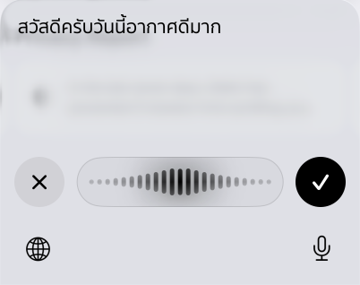
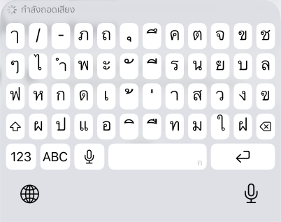
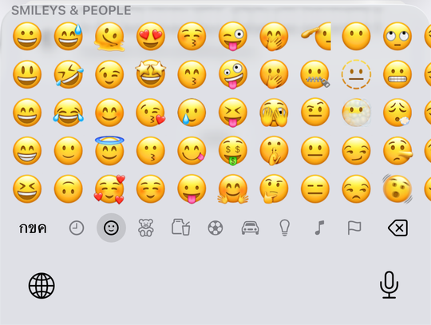
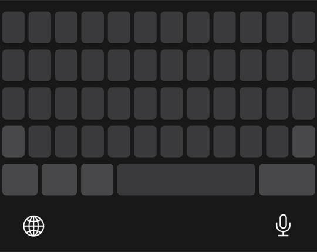
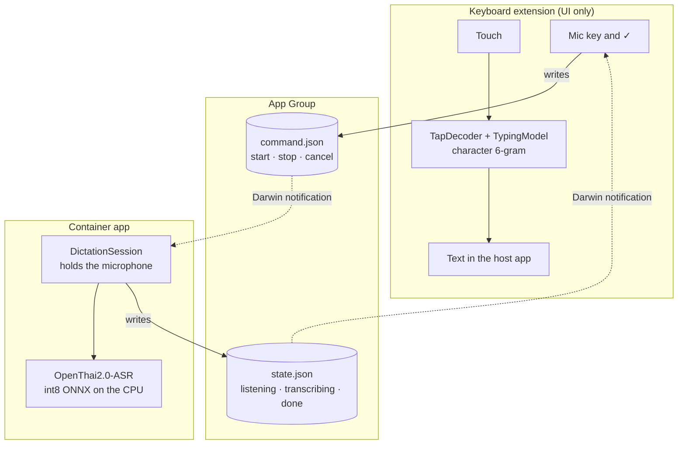

<div align="center">


# เว่า · Wao

**คีย์บอร์ดพิมพ์ด้วยเสียง พูดไทยปนอังกฤษ ถอดเสียงบนเครื่อง**<br>
An offline Thai–English dictation keyboard for iPhone.

[](#build)
[](Packages/WaoCore/Package.swift)
[](LICENSE)
[](https://testflight.apple.com/join/jU4rVm8a)
[](#how-it-works)
[](https://github.com/peerasak-u/Wao/issues)

[Website](https://wao.peerasak.com) · [TestFlight](https://testflight.apple.com/join/jU4rVm8a) · [Report a bug](https://github.com/peerasak-u/Wao/issues/new?template=bug.yml) · [Ideas](https://github.com/peerasak-u/Wao/issues/new?template=feedback.yml)

<br>






<sub>Dictation with live words · Thai Kedmanee · Emoji · Space-bar trackpad</sub>

</div>

## What it does

Wao is a keyboard for iPhone that turns speech into text in any app. Speak Thai with English words mixed in, and
Wao writes the English words in Latin letters. The speech model runs on the phone. No audio leaves it.

| | Feature |
| :-: | --- |
| 🎙️ | **Offline Thai–English dictation.** [OpenThai2.0-ASR](https://huggingface.co/iapp/OpenThai2.0-ASR-Streaming) runs on the device with ONNX Runtime. |
| ✓ | **One tap to talk, one tap back.** Tap the mic, speak, and tap ✓. The keyboard returns to typing at once and inserts the text when it is ready. |
| ⌨️ | **Thai Kedmanee.** The key layout and fonts match Apple's own keyboard. English words come from dictation, or from the system keyboard through the globe. |
| 😀 | **Emoji.** The emoji key opens a panel like iOS's: categories, frequently used and skin tones. |
| 🎯 | **Tap decoding.** A near miss types the key you meant. Fast typing leans more on context. Slow, careful taps count where they land. |
| 💬 | **Word suggestions.** The strip above the keys completes the word you are typing. |
| ↔️ | **Space-bar trackpad.** Hold space and drag to move the cursor, one Thai character at a time. |
| 📖 | **Your own vocabulary.** Add names, products and work terms in groups you can turn on and off. Dictation favours them. |
| 🔒 | **No accounts, no analytics.** The app downloads the model once at setup. After that, nothing about you or your speech leaves the phone. |

## How it works

An iOS keyboard extension cannot record audio, and its memory limit is far below the 0.88 GB of int8 encoder
weights. So the keyboard is UI only. The container app holds the mic and runs the speech model. The two talk through files in the shared App Group, and a
Darwin notification tells the other side to re-read. Each file has exactly one writer.



The keyboard writes `command.json`. The app's `DictationSession` writes `state.json` and the audio `level`. Both
files are defined in `Packages/WaoCore/Sources/WaoCore/Bridge.swift`. The typing path never leaves the keyboard. See
[Typing model](#typing-model).

## Contributing

Bug reports and ideas are welcome, in Thai or English.

- **Report a bug or share an idea** with the [issue forms](https://github.com/peerasak-u/Wao/issues/new/choose). The
  bug form asks for your iPhone model, iOS version, the Wao build from TestFlight, and whether Full Access is on.
  Install the latest [TestFlight](https://testflight.apple.com/join/jU4rVm8a) build before you report.
- **Pull requests** are welcome for bug fixes, transcription quality, typing accuracy, and accessibility. For a
  larger change, open an issue first so we can agree on the shape.
- **Before you open a PR**, follow [Build](#build), run the tests in [Test](#test), and, for a change to typing
  or the speech model, compare numbers with [Evaluate](#evaluate) or `wao-typing-eval`.

## Build

```sh
tools/fetch_onnxruntime.sh   # ONNX Runtime 1.32.0 xcframework from Microsoft's NuGet package, pinned by hash
xcodegen generate            # Wao.xcodeproj from project.yml
open Wao.xcodeproj
```

## Test

```sh
cd Packages/WaoCore && swift test     # model tests skip unless .model-cache/int8 holds the model
```

To run the model tests, put `encoder.int8.onnx.data` and the extracted `.asr.zip` in `.model-cache/int8`.
`tools/reference_transcribe.py` is the Python reference the Swift fixtures in
`Packages/WaoCore/Tests/WaoCoreTests/Fixtures` come from; `tools/make_samples.sh` regenerates `samples/`.

## Evaluate

```sh
cd Packages/WaoCore && swift build -c release --product wao-transcribe
.build/release/wao-transcribe --language th-mix --decoding beam ../../samples/*.wav   # JSON lines: file, text, seconds
```

`tools/asr_eval.py` runs it over PoodPim's Thai/English eval set and writes results its `eval.py report` scores.
`tools/reference_beam.py` is PoodPim's beam search transcribed to Python on the reference encoder; its tokens match
the Swift beam's exactly (`wao-transcribe` prints `tokens` too).

## Typing model

The Thai letters page types the key a touch most likely meant, from where the finger landed, how fast the typing is
and what came before, and the strip above the keys offers completions of the word being typed. Both read
`Packages/WaoCore/Sources/WaoCore/Resources/thai-typing.bin`, a pruned character 6-gram and word list memory-mapped
by `TypingModel`. Every tunable lives in `TapTuning.shipped`.

```sh
uv run tools/build_typing_model.py   # downloads the pinned corpora into .model-cache/typing-corpora, writes the .bin
```

The build also rewrites the test fixtures it derives: the held-out lines it never trained on and golden
probabilities the Swift reader must reproduce. The same sources and options give the same bytes.

```sh
cd Packages/WaoCore && swift build -c release --product wao-typing-eval
.build/release/wao-typing-eval            # JSON lines: fixed-noise table, speed buckets, latency, border taps to try
.build/release/wao-typing-eval sweep      # the speed mix over a grid of tunings, best first
```

`wao-typing-eval` replays the held-out lines as noisy taps on a 390 x 242 pt key grid through the shipped
`KeyLayout`, `TypingModel` and `TapDecoder`, and counts what the geometric keyboard and each decoder typed.

## Credits

- **Speech recognition model.** [OpenThai2.0-ASR-Streaming](https://huggingface.co/iapp/OpenThai2.0-ASR-Streaming)
  by **iApp Technology**, launched with **AIEAT** and released free under
  [OpenMDW-1.1](https://openmdw.ai/license/1-1/). It is part of OpenThai (formerly OpenThaiGPT) and built on NVIDIA's
  Nemotron ASR streaming model. The app downloads the int8 files of its ONNX export,
  [iapp/OpenThai2.0-ASR-Streaming-ONNX](https://huggingface.co/iapp/OpenThai2.0-ASR-Streaming-ONNX), at setup.
  Thank you to iApp and AIEAT for opening it up.
- **[ONNX Runtime](https://www.nuget.org/packages/Microsoft.ML.OnnxRuntime/1.32.0) 1.32.0** (Microsoft, MIT) runs
  the model and ships inside the app.
- **[PoodPim](https://github.com/thirawat/PoodPim)** (MIT, Thirawat Sutalungka). The beam search with hotword
  biasing, the text clean-up and the default vocabulary and corrections lists are adapted from it.
- **Typing data** (CC0). Common Voice Thai sentences, wisesight-sentiment and PyThaiNLP's word list and Thai
  National Corpus frequencies. The keyboard's language model and word suggestions are built from them.
- **[Unicode Emoji 15.0](https://www.unicode.org/Public/emoji/15.0/emoji-test.txt)** (Unicode, Inc., Unicode
  License V3). The emoji keyboard's emoji, their names and skin tones are built from its `emoji-test.txt`.

The app shows all of this, with each licence in full, under เครดิตและสัญญาอนุญาต at the foot of its main screen.
The texts live in `Packages/WaoCore/Sources/WaoInference/Resources` (the model's notice of origin with OpenMDW-1.1,
and ONNX Runtime's LICENSE and ThirdPartyNotices, which `tools/fetch_onnxruntime.sh` copies from the NuGet package)
and `Packages/WaoCore/Sources/WaoCore/Resources/THIRD_PARTY_NOTICES` (PoodPim, the typing data and Unicode).

## License

The code is [MIT](LICENSE). The model, the ONNX Runtime binaries, the typing data and the emoji data keep their
own licences, listed under Credits.

<br>

<p align="center"><sub>Made in Thailand with ❤️ for Thai typists.</sub></p>
